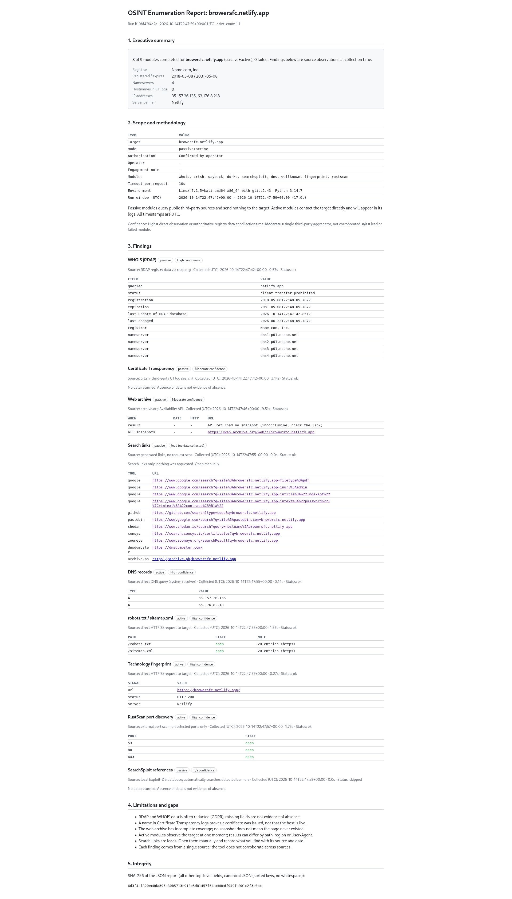
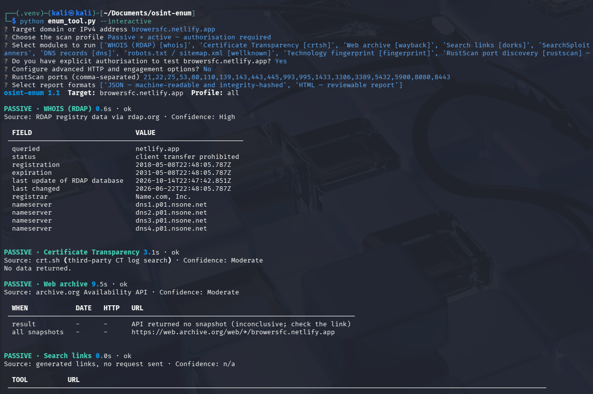
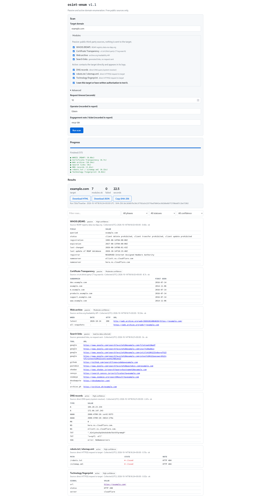

# OSINT Enum

Herramienta de línea de comandos en Python para practicar enumeración pasiva y activa de dominios. Incluye:

- Enumeración pasiva y activa de dominios, con informes JSON y HTML.
- Comprobador de cabeceras de seguridad HTTP.
- Servidor local que muestra y registra el `User-Agent` recibido.
- Interfaz web local.


> **Uso responsable:** ejecuta módulos activos solo sobre dominios propios o con autorización explícita. Las consultas activas contactan con el objetivo y pueden quedar registradas.

## Instalación

```bash
python3 -m venv .venv
source .venv/bin/activate   # Windows: .venv\Scripts\activate
python -m pip install -r requirements.txt
```

Activa el entorno virtual en cada terminal nueva.

## Uso

### Enumeración de dominios

```bash
# Pasiva (por defecto): no contacta con el dominio
python enum_tool.py -d example.com

# Activa: requiere confirmar autorización
python enum_tool.py -d example.com -m active --i-have-permission

# Todos los módulos, con informes en output/
python enum_tool.py -d example.com -m all --i-have-permission --json --html

# Listar o filtrar módulos
python enum_tool.py --list-modules
python enum_tool.py -d example.com --only whois,crtsh
python enum_tool.py -d example.com --exclude searchsploit
```



### Asistente interactivo

```bash
python enum_tool.py --interactive
```

Guía la selección de perfil, módulos e informes. En una terminal interactiva, `python enum_tool.py` sin argumentos también lo abre.



### Opciones HTTP

| Opción | Descripción |
|---|---|
| `--timeout` | Timeout en segundos (3–30, por defecto 10) |
| `--user-agent` | User-Agent personalizado |
| `--header` | Cabecera extra `Nombre: valor` (repetible) |

```bash
python enum_tool.py -d example.com --user-agent "OSCP-lab/1.0" \
  --header "X-Engagement: LAB-42" --timeout 15
```

Los informes registran los nombres de las cabeceras personalizadas, pero no sus valores. Consulta `--help` para ver todos los límites.

### Módulos opcionales externos

- **RustScan:** instálalo aparte y comprueba que esté en `PATH`. No se ejecuta nunca por defecto; hay que seleccionarlo y confirmar autorización.

  ```bash
  python enum_tool.py -d 192.0.2.10 --only rustscan --i-have-permission \
    --rustscan-ports 22,80,443 --rustscan-timeout 90
  ```

- **SearchSploit:** si está instalado, en escaneos activos busca referencias a partir de las versiones detectadas. No ejecuta exploits.

### Cabeceras de seguridad

```bash
python headers_check.py [https://example.com](https://example.com)
```

### Captura de User-Agent

En una terminal, inicia el servidor:

```bash
python ua_server.py --port 8080
```

En otra, haz una petición:

```bash
python headers_check.py http://127.0.0.1:8080
```

El `User-Agent` se muestra en la primera terminal y se guarda en `output/user_agents.log`. Detén el servidor con `Ctrl+C`.

### Interfaz web

```bash
python web_server.py
```

Abre <http://127.0.0.1:8000>. No tiene autenticación: no la expongas a una red pública.

